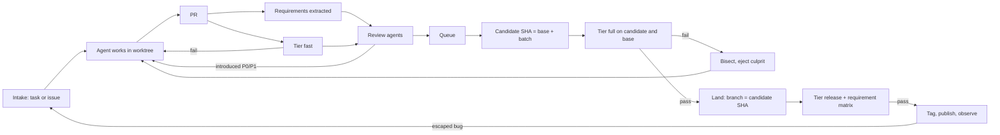

# Philium pipeline: a generic agent-to-release factory

Status: design, 2026-11-20. Nothing here is specific to one repo or one PR. Each repo declares itself in `.philium/pipeline.yaml`. Philium runs the same stages for every repo and every PR.

## What "top end" teams do, and what Philium takes from each

| Practice | Who | Philium rule |
|---|---|---|
| "Not rocket science" rule: the branch only ever moves to a commit that passed the full tests as merged | bors / Rust, Graydon Hoare | Land = move the branch to exactly the tested candidate SHA. Never merge an untested combination. |
| Speculative merge queue with batching and bisection | Uber SubmitQueue, Chromium CQ, Trunk | Philium queue: batch, test, bisect on failure, eject the culprit |
| Hermetic, reproducible test environments | Google TAP / Bazel | Every check runs in a disposable container with an isolated HOME, services brought up per run |
| Presubmit (fast) vs postsubmit (full) tiers | Google, Chromium | Tier `fast` on every push, tier `full` on the queue candidate, tier `release` on the release SHA |
| Flake detection and quarantine | Google, Mergify, Trunk | Rerun on failure. Failing on base too = pre-existing. Intermittent = flaky, quarantined, visible, never "passed". |
| Merge-first + auto-revert at very high volume | Jackson Felty "CI/CD factory" | Optional mode `land: optimistic` when a repo needs more than ~20 PRs/hour. Off by default. |
| A factory dashboard showing every PR's stage | Felty | Philium "Factory" screen built from the same run records |
| Backtesting the gate on known bugs | Mutation testing, defect benchmarks | Replay: rerun the gate on historic buggy commits and prove it catches them (see "Proving the gate works") |

## Invariants (hold for every repo, enforced in code, not config)

1. **Exact SHA.** Every result records the head, base and candidate SHAs. A new head invalidates every earlier result for that PR.
2. **Tested = landed.** The default branch is only moved to a SHA with a passing `philium/gate` status. Branch protection requires that status.
3. **Base comparison.** Every failing check is rerun on the base SHA on the same fixture. Origin is computed (`introduced`, `pre_existing`, `flaky`), never guessed by an agent.
4. **Isolation.** Checks never read or write the host HOME, real credentials or real environments unless the check is declared `environment: <name>` and that environment is enrolled read-only.
5. **No silent downgrade.** A check that cannot run as declared (wrong platform, missing service, missing secret) is `not_run`, which blocks. It is never `passed`.
6. **Every requirement maps to evidence.** Every requirement on a PR (see Intake) has a check and a result, or it blocks.
7. **Agents report, Philium decides.** Agent findings feed the verdict. The verdict is computed from records, never written by an agent.
8. **Escapes become checks.** A bug found after landing reopens the gate definition: the fix PR must add a check that fails on the old SHA and passes on the fix.

## Stages



### 1. Intake: requirements, from wherever they live
Requirements come from any source attached to the PR: the PR body, linked issues, test plans posted as comments or files, review threads, findings issues, and PRs that target the PR's branch. An extractor agent turns each source into **requirement rows** (`id`, `source`, `text`, `priority`). The **read cursor** (last comment or commit read per source) is stored, so later comments are picked up on the next sweep. The rows are recorded, not interpreted: each needs a mapped check or an explicit `waived_by: <human>`.

Generic outcome: a test plan of 5 rows or 500 rows is handled the same way, and a release cannot land with an unmapped or unrun P0 row.

### 2. Tier `fast` (minutes, every push)
Build, lint, unit tests, generated-code drift, secret scan, as declared. It runs on a self-hosted GitHub Actions runner (free) through one generic workflow that calls `philium run fast`.

### 3. Review
Review agents follow REVIEW-STANDARD.md: sweeps, two append-only lists, severity P0 to P5. Origin comes from stage 5's base comparison, not from agent judgment.

### 4. Queue
Philium's own queue, since GitHub's merge queue needs Enterprise Cloud for private repos. Entry requires: fast tier green on the current head, every requirement row mapped, no open introduced P0/P1. Batch size adapts to the recent failure rate (1 when above 20%, up to `batch_max` otherwise).

### 5. Tier `full` (the real acceptance)
The declared matrix runs on the candidate and on the base, in parallel, on identical fixtures. Results per check: `pass`, `fail(introduced)`, `fail(pre_existing)`, `flaky`, `not_run`. Only `pass`, `fail(pre_existing)` (filed as an issue) and quarantined `flaky` allow landing.

### 6. Land
Post `philium/gate=success` on the candidate SHA, then push the branch to that SHA. If the base moved, rebuild the candidate. A failed batch is bisected, the culprit goes back to its agent with evidence, and the rest is retried.

### 7. Release
Tier `release` runs on the release SHA: contracts, migrations on a copy of real-shaped data, deploy to a disposable environment, smoke tests. The requirement matrix must be complete. Approval goes through `review_gate.py`.

### 8. Observe
After deploy, declared health probes run. A regression opens an intake item linked to the release, and invariant 8 applies.

## Repo contract: `.philium/pipeline.yaml`

Generic schema. Repos only fill it in.

```yaml
version: 1
branch: <default branch>
land: { mode: tested | optimistic, method: squash | merge | rebase, batch_max: 4 }
platforms: [linux/amd64]              # where checks may run, others become not_run
services:                             # any compose service, kind cluster, or command
  <name>: { compose: <file>, service: <svc> } | { kind: { manifests: <dir> } } | { run: <cmd>, ready: <probe> }
secrets: [<NAME>]                     # names only, values from Keychain, never in logs
fixtures: { <key>: "<template using ${port.x}, ${run}>" }
tiers:
  fast:    [ { id, run, needs?, timeout, platform? } ]
  full:    [ ... ]
  release: [ ... ]
requirements:
  sources: [pr_body, linked_issues, pr_comments, review_threads, child_prs]
  block_on_unmapped: [P0, P1]
environments:                         # read-only observation targets, enrolled by a human
  <name>: { client: <program>, allowed_verbs: [...] }
```

Philium code knows only these concepts. Repo names, branches, kind contexts, namespaces, verifier repos, URLs and ports all come from this file.

## Proving the gate works ("simulation")

Claims like "no mistakes" are tested, not asserted:

1. **Replay set.** Each repo keeps `.philium/replay.yaml`: historic commits with a known bug, and the check expected to catch it. It is built from every escaped bug (invariant 8).
2. **Replay run.** `philium replay` reruns the gate on each buggy SHA. Catch rate = caught / total. A gate change that lowers the catch rate is rejected.
3. **Synthetic load.** `philium simulate --prs N --fail-rate p` feeds fake PRs through the queue logic to tune batch size and confirm bisection, as Felty's dashboard does with real ones.
4. **Mutation sampling (later).** Inject small faults into changed code and confirm tier `full` fails.

The dashboard shows queue depth, time to land, red time, reverts, catch rate on the replay set and escaped bugs per release.

## What changes in Philium code

| Today | Change |
|---|---|
| Repo specifics in Rust (kind context `kind-*`, namespace, verifier repo name, fixture hosts) | Read from `.philium/pipeline.yaml` |
| `check_worker.py`: Make targets only, 600 s max, host process | Generic runner: declared command, per-check timeout, container, services, platform |
| Review origin decided by agents | Computed from base vs candidate runs |
| No requirement intake | Extractor + read cursors + requirement matrix |
| No queue or land | `queue.rs`: candidate, batch, bisect, status, push |
| No replay | `philium replay`, `philium simulate` |

## Rollout

1. Branch protection requiring `philium/gate` (human decision, done outside Philium).
2. Generic runner + config parser + base comparison. First repo: one real product repo. Second: another, with no code changes, only a config file. **That's the test of "not hardcoded".**
3. Requirement intake + matrix.
4. Queue + land, single-PR batches first.
5. Replay set from known escaped bugs, then batching, then the dashboard.
