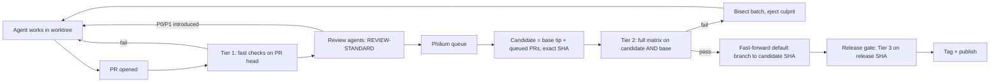

# Philium pipeline: from agent work to a release, with no paid services

Status: proposal, 2026-11-20. Replaces hardcoded per-repo knowledge with one declared file per repo.

## Facts this design is built on (checked 2026-11-20)

| Fact | Consequence |
|---|---|
| example-org is on the GitHub **Team** plan; example-repo and exo are **private** | GitHub's merge queue requires Enterprise Cloud for private repos. **It is not available.** Philium must run the queue itself. |
| example-repo `main.yml` only installs the published CLI and runs `mycli version`. Exo has no workflows | Neither repo has CI that tests a PR today. "Green" currently means nothing. |
| example-repo default branch `release/v1.1.x`, exo `dev`. No branch protection. Exo rulesets only block deletion and force-push | Anyone (or any agent) can push straight to the default branch. |
| example-repo: ~66 PRs merged in the last week | The volume is about 10/day, not 30/hour. Use test-before-merge. Merge-first plus revert is not needed. |
| Real bugs in example-repo PR 5525 were caught only by a disposable API + Postgres + kind stack with real targets (20 to 40 min), with DB row checks and a base-vs-head comparison | Unit tests are a cheap filter, not acceptance. |
| Slips: compile-only or wrong-platform passes counted as acceptance; host HOME contamination; base not run, so origin was guessed | Every one of these is a pipeline rule below. |

"No mistakes" cannot be promised by any pipeline. What can be promised: **nothing reaches the default branch or a release unless the exact SHA passed every declared check, in isolation, and was compared with its base.** Mistakes then come only from missing checks, and each escaped bug becomes a new declared check.

## The model



1. **Tier 1 (minutes, every push):** build, `vet`, `lint`, unit tests, generated-code checks (`openapi-check`, `authzgen-check`), `check-secrets`. Runs on a free self-hosted runner (your Mac / miyuki etc.) via a GitHub Actions workflow with `pull_request`. Self-hosted runner minutes are free.
2. **Review:** Philium's review_run with REVIEW-STANDARD. Findings carry severity and origin. Introduced P0/P1 blocks. Pre-existing findings never block, but are filed as issues, never dropped.
3. **Queue (Philium, local):** this replaces GitHub's merge queue. It builds a candidate commit = current base tip + the queued PRs, in order. Batch size is adaptive: 1 when the recent failure rate is above 20%, up to 4 otherwise.
4. **Tier 2 (the real acceptance, 20 to 40 min):** the declared workflow matrix runs against the candidate SHA **and** the base SHA on the same disposable fixture, in containers with an isolated HOME. A check fails only if it fails on the candidate and passes on base (introduced). Fails on both = pre-existing, filed, not blocking.
5. **Land:** Philium posts a commit status `philium/gate` on the candidate SHA, then fast-forwards the default branch to exactly that SHA. Branch protection requires `philium/gate`, so nothing else can merge. If the base moved meanwhile, the candidate is rebuilt. No merge happens without the tested SHA.
6. **Failure:** bisect the batch (halve, rerun), eject the culprit PR back to its agent with the failing evidence, and continue with the rest.
7. **Release gate (Tier 3):** the existing release_verify / sql-contracts / environment checks run on the release SHA. Approval goes through `review_gate.py`. It never auto-approves while findings are unresolved.

## The one config file per repo: `.philium/pipeline.yaml`

This is what removes the hardcoding. Philium reads it at the pinned SHA. Nothing repo-specific lives in Rust.

```yaml
version: 1
default_branch: release/v1.1.x        # exo: dev
merge: { method: squash, batch_max: 4 }
services:                             # brought up per run, torn down after
  postgres: { compose: test/compose.yaml, service: db, port: 5433 }
  redis:    { compose: test/compose.yaml, service: redis }
  kind:     { cluster: "philium-${run}", manifests: deploy/kind }
isolation: { container: true, home: ephemeral }   # never the real ~/.mycli
tiers:
  fast:   # every PR push
    - { id: build, run: make build-local-backend, timeout: 15m }
    - { id: unit,  run: make test-short, timeout: 15m }
    - { id: lint,  run: make lint, timeout: 10m }
  full:   # queue candidate, compared with base
    - { id: session,     run: make test-session,     needs: [postgres], timeout: 20m }
    - { id: integration, run: make test-integration, needs: [postgres, redis], timeout: 30m }
    - { id: infra,       run: make test-infra,       needs: [kind], timeout: 40m, platform: linux/amd64 }
  release:
    - { id: contracts, verifier: philium/sql-contracts.json }
secrets: [MYCLI_TEST_TOKEN]        # names only, values from Keychain
fixtures: { api_url: "http://127.0.0.1:${port.api}" }   # no hardcoded hosts or ports
```

Rules Philium enforces whatever the file says:
- Exact SHAs recorded for head, base and candidate. A new head means a new run.
- `platform:` is honored. A check declared amd64 never passes on arm64. Instead it is reported **not run**.
- Skipped, blocked and not-run checks stay visible and block the land.
- Evidence (logs, exit codes, DB row dumps) is stored per run. Secrets are redacted.

## What changes in Philium

| Today | Change |
|---|---|
| `release_command.rs` allows only `kind-*` contexts, tests assume `kind-review` and ns `mycli` | Allowed contexts and namespaces come from `services.kind` in the config |
| Verifier is a separate repo `philium-verifier-example-repo` pinned by name | Move into each repo as `.philium/`, pinned by SHA like now |
| Repo test matrix lives in docs and agent memory | `.philium/pipeline.yaml` |
| `check_worker.py`: Make targets only, 600 s max | Any declared command, per-check timeout, containerized, needs-services |
| No queue, no land step | New `queue.rs`: candidate build, base comparison, bisect, status post, fast-forward |
| Fixture URLs/ports in code (malformed `http://http/...` needed shims) | `fixtures:` with allocated ports |

## Rollout (each step is usable alone)

1. **Protect branches (5 min, free):** ruleset on `release/v1.1.x` and `dev`. Require a PR and the status `philium/gate`, block direct pushes, allow the Philium bot to bypass only for the fast-forward.
2. **Tier 1 CI:** register one self-hosted runner and add `.github/workflows/philium-fast.yml` calling `philium-run fast`. Replace example-repo's no-op `main.yml`.
3. **Config + runner in Philium:** `pipeline.yaml` parser, containerized runner, base-vs-head comparison. Start with example-repo, using the fixture from PR 5525.
4. **Queue + land:** single-PR batches first, batching + bisect after two weeks of data.
5. **Exo:** write its `pipeline.yaml` (`test`, `openapi-check`, `authzgen-check`, `smoke-e2e`).
6. **Escape loop:** every bug found after landing gets a check added to `pipeline.yaml` in the fix PR. The fix PR must fail that check on base.
