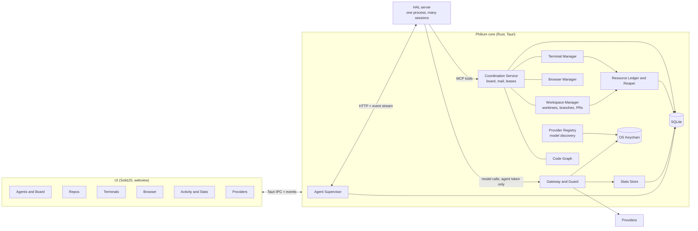
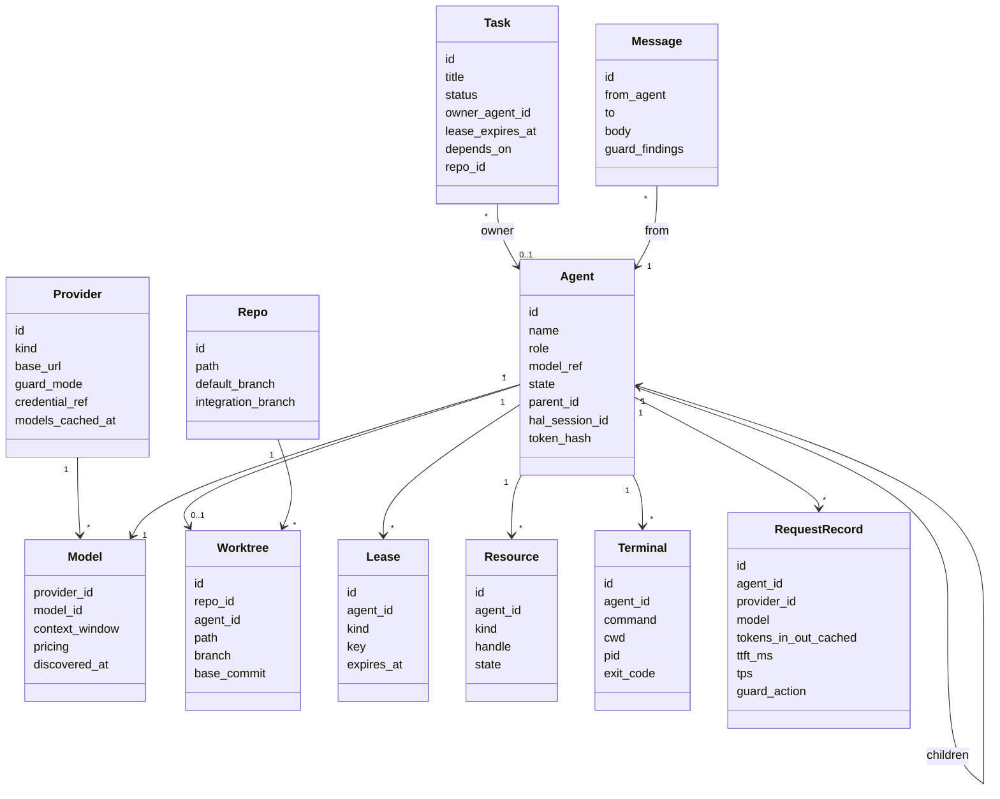
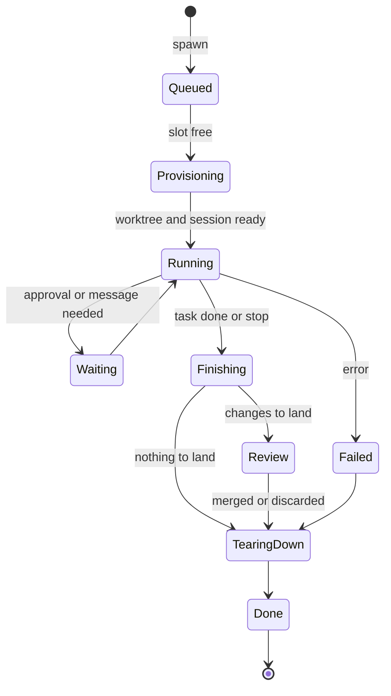
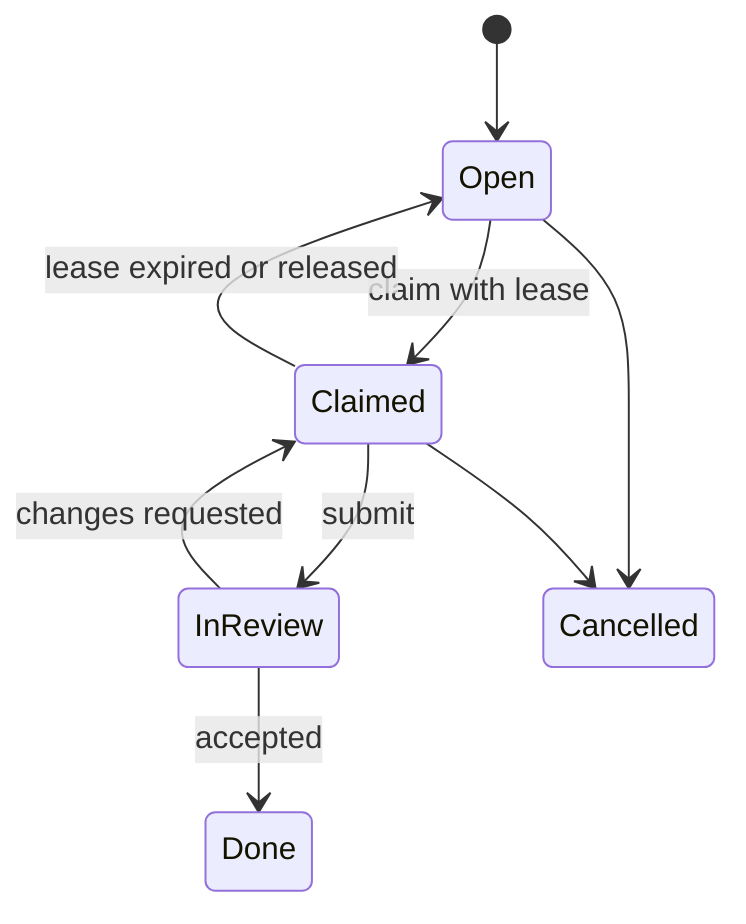
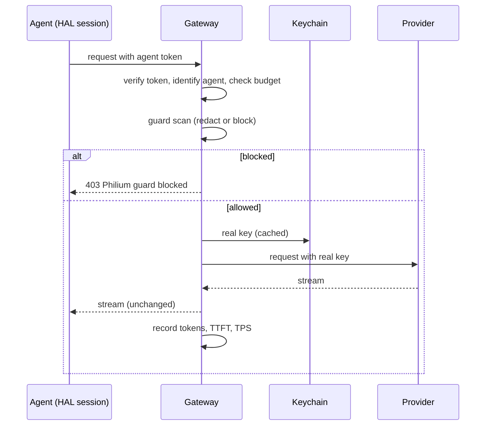
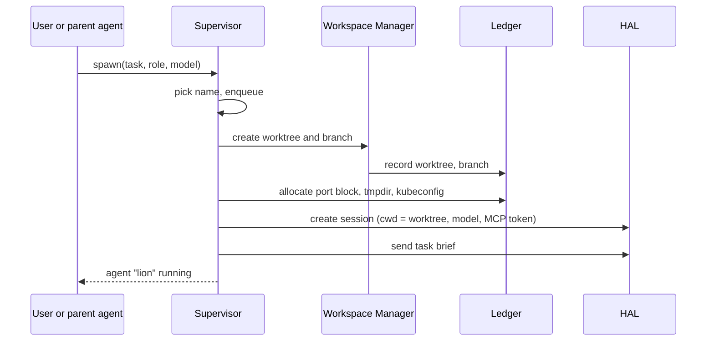
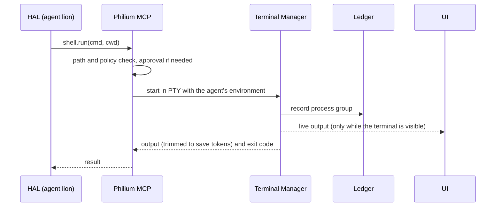
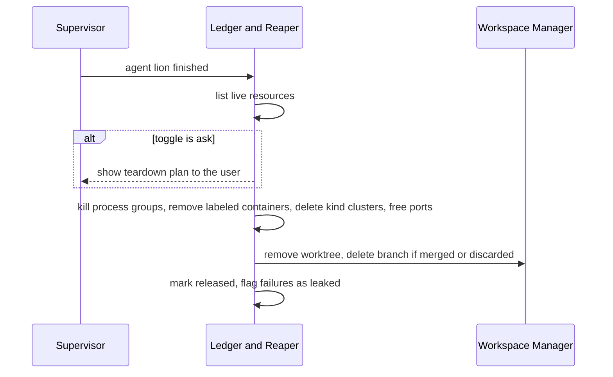

# Philium: Software Specification

Status: **draft v0.1** (2026-11-16). Open decisions are marked **[OPEN]**.

## 1. Purpose

Philium is a native, secure agent workstation. It replaces:

| Replaces | With |
|---|---|
| jcode / pi (harness) | HAL runtime driven by Philium, with named agents, a shared todo board and messaging |
| Herdr (terminals) | Persistent, live terminals owned by Philium |
| Orca (browser) | One built-in, interactive browser panel |
| Keys in env vars | A gateway that holds every credential and filters every request |

Design goals, in priority order:

1. **Safe with any provider.** Agents never hold real credentials. Every model request is inspected and logged.
2. **Agents never step on each other.** Each agent has its own workspace, resources and identity (section 6).
3. **Hundreds of agents on one machine.** The UI and supervisor cost almost nothing per idle agent.
4. **Nothing hardcoded.** Models are discovered live from providers.
5. **Leaves no mess.** Everything an agent creates is recorded and torn down.
6. **Premium, calm, dark UI.** Our own component set, inspired by affectUI's style (no copied code).

## 2. Requirements

### Functional

| ID | Requirement |
|---|---|
| F1 | Add a provider by picking a type (Claude Code, Codex, OpenAI-compatible) and pasting a key or signing in. |
| F2 | Model lists are fetched from each provider and refreshed. New models appear without a rebuild or restart. |
| F3 | All model traffic goes through the gateway: credential injection, secret redaction/blocking, logging. |
| F4 | Agents have unique names (lion, otter, ...), a role, a model and an owner (user or parent agent). |
| F5 | One master todo board shared by all agents. A task has one owner at a time. |
| F6 | Agents message each other (direct and broadcast) and hand off tasks. Messages are secret-scanned. |
| F7 | Each agent working on a repo gets its own git worktree and branch. |
| F8 | Repo view: repos, worktrees, branches, owning agent, dirty/ahead/behind state. |
| F9 | Every shell command an agent runs is visible as a live terminal. Terminals persist and can be reopened. |
| F10 | Built-in interactive browser panel that agents can drive and the user can watch and take over. |
| F11 | Resource ledger: processes, containers, kind clusters, ports, worktrees, branches, temp dirs per agent. |
| F12 | Teardown on agent finish, with a global toggle: **auto** or **ask**. Crash-recovery sweep at startup. |
| F13 | Statistics: tokens, cost, TPS, latency, cache hits, errors, guard hits, by provider/model/agent/repo/day. |
| F14 | Code graph (Graphify) per repo, exposed to agents as a cheap lookup tool. |
| F15 | Approvals: risky actions (push, delete, network, writes outside the workspace) show what will happen before you allow them. |
| F16 | Improve Philium from inside Philium: request a change on any screen, an agent builds it, you preview, accept or roll back. |
| F17 | Playbooks: one written standard per job (commit, PR, test, review, docs, release, teardown), enforced by checks and shown in the UI. |

### Non-functional

| ID | Requirement |
|---|---|
| N1 | Idle agent overhead: no OS process, no rendered DOM, < 1 MB RAM in Philium. |
| N2 | UI renders only visible rows (virtualized). 1,000 agents in a list costs the same as 20. |
| N3 | One HAL server process for all agents. |
| N4 | macOS first. Windows and Linux follow without architectural change. |
| N5 | No secret is ever written to disk outside the OS keychain. Logs on disk hold metadata only. |
| N6 | No agent limit. Every agent you start runs immediately. Philium handles provider rate limits (backoff on 429, per-provider request pacing) and shows CPU, memory, disk and rate-limit headroom so you can see when the machine is saturated. |

## 3. Architecture



Key choice: **Philium offers its services to agents as MCP tools**, served by the core over loopback with a per-agent token. HAL stays unmodified. The token tells Philium which agent is calling, so every tool call is attributed and scoped to that agent.

### 3.1 Components

| Component | Responsibility |
|---|---|
| Agent Supervisor | Creates HAL sessions, assigns names, tracks state. No concurrency cap. |
| Coordination Service | Todo board, mailboxes, leases. Offered to agents as MCP tools. |
| Workspace Manager | Repo registry, worktree and branch lifecycle, PR creation, serialized git operations. |
| Resource Ledger | Records every resource an agent creates. The Reaper tears them down. |
| Terminal Manager | Owns all agent shell processes in PTYs. Keeps a ring buffer per terminal. |
| Browser Manager | One webview, created on first use. Agents take a lease to drive it. The user can take over. |
| Gateway and Guard | Exists today. Gains per-agent attribution, budgets and rate limits. |
| Provider Registry | Provider types, credentials (keychain), live model discovery and caching. |
| Stats Store | Aggregated counters in SQLite. Raw events kept for 30 days. |
| Code Graph | Builds and updates a Graphify index per repo. Answers lookups. |

## 4. Domain model



Enumerations:

- `Provider.kind`: anthropic, openai, openai_compatible, chatgpt_subscription, claude_subscription
- `Provider.trust`: trusted (Standard), untrusted (forces Strict)
- `Provider.guard_mode`: off, redact, block
- `Lease.kind`: task, path, port_block, browser
- `Resource.kind`: process, container, compose_project, kind_cluster, port_block, worktree, branch, tmpdir
- `Resource.state`: live, released, leaked

## 5. Lifecycles

### 5.1 Agent



### 5.2 Task



A task can only be claimed when all of its `depends_on` tasks are Done.

## 6. Isolation: agents never step on each other

Every shared thing that agents could fight over gets one of three treatments: **each agent gets its own copy**, **it is leased to one agent at a time**, or **Philium serializes access**.

| Shared thing | Typical collision | Rule | Mechanism |
|---|---|---|---|
| Working tree | Two agents edit the same files | Own copy | One worktree per agent. The agent starts there. Writes outside it require approval. |
| Branches | Agents commit to the same branch | Own copy | Branch `philium/<agent>/<slug>`. Git refuses to check out one branch twice. Pushes to protected branches are denied. |
| Landing changes | Merge conflicts, broken main | Serialize | Every agent's work lands as a GitHub PR, following the playbooks (section 6.3). Before opening, the agent rebases on the default branch and runs checks. If PRs conflict, the later one goes back to its agent to rebase. |
| Git metadata | `index.lock` races | Serialize | Worktree create/remove, fetch and gc run through one Workspace Manager queue. |
| Tasks | Two agents do the same work | Lease | Claiming gives an exclusive lease with a heartbeat. An expired lease reopens the task. |
| Ports | `EADDRINUSE`, or an agent hits another agent's server | Own copy | Each agent gets a block of 20 ports (`PHILIUM_PORT_BASE`). `PORT` defaults inside it. |
| Docker / compose | Name clashes, `down` kills others | Own copy | `COMPOSE_PROJECT_NAME=philium-<agent>`. A `docker` shim adds the label `philium.agent=<agent>`. |
| kind / Kubernetes | Shared kubeconfig, wrong context, deleted cluster | Own copy | Per-agent `KUBECONFIG`. A `kind` shim prefixes cluster names with `philium-<agent>-`. |
| Temp files | Overwrites | Own copy | Per-agent `TMPDIR`. Build caches stay shared (safe and fast). |
| Browser | Two agents drive one page | Lease | One browser lease at a time. Others wait or get their own tab. |
| Sibling worktrees | Agent reads or edits another agent's files | Deny | Path rules deny other agents' worktrees. |
| Credentials | Agent reads `~/.ssh` or cloud credentials | Deny | Environment scrubbed. Strict mode sandboxes the filesystem (section 9). |
| Model budget | One agent uses up all quota | Limit | Per-agent and per-provider token and rate budgets in the gateway. |

The shims (`docker`, `kind`, `git`, `kubectl`) live in a Philium `bin` folder placed first on the agent's `PATH`. They record created resources in the ledger and enforce naming. They are a convenience, not a security boundary. Strict mode is the boundary.

### 6.1 Agent environment

Every agent process starts with exactly this. Nothing that carries credentials is inherited.

```
PHILIUM_AGENT=lion
PHILIUM_PORT_BASE=42100
PORT=42100
TMPDIR=<state>/agents/lion/tmp
KUBECONFIG=<state>/agents/lion/kubeconfig
COMPOSE_PROJECT_NAME=philium-lion
PATH=<state>/bin:<user PATH>
```

### 6.2 Teardown policy

Status: **proposed defaults, not yet confirmed by the user.**

**When teardown runs**

| Trigger | What happens |
|---|---|
| Agent finishes, work landed or discarded | Full teardown of that agent's resources |
| Agent finishes, work waiting for review | Runtime resources torn down now (processes, containers, clusters, ports). Worktree and branch kept until you accept or discard |
| Agent fails or is stopped | Same as above. Worktree kept for 24 h so you can inspect it, then removed |
| Philium quits | All agent processes stopped. Containers and clusters kept, so agents can resume. Reaped at next start if their agent is gone |
| Philium starts | Reconcile sweep (below) |
| Idle timeout | A resource with no activity for N hours (default 4) is flagged, then torn down per the toggle |

**The toggle** (Settings, with per-repo override): **Auto** tears down without asking. **Ask** shows the teardown plan (what will be removed) and waits for one click. Default: **Ask** for the first week, then you decide.

**What gets torn down and how**

| Resource | How it is found | How it is removed |
|---|---|---|
| Processes | Process group recorded at spawn | SIGTERM to the group, SIGKILL after 5 s |
| Docker containers, volumes, networks | Label `philium.agent=<agent>` | `docker rm -f`, `docker volume rm`, `docker network rm` by label |
| Compose projects | `COMPOSE_PROJECT_NAME=philium-<agent>` | `docker compose -p philium-<agent> down -v` |
| kind clusters | Name prefix `philium-<agent>-` | `kind delete cluster --name ...` |
| Colima / Docker runtime | Shared, never owned by one agent | Never stopped by teardown. Stopped only if Philium started it and no agent uses it (setting, default off) |
| Ports | Port block in the ledger | Freed after the owning processes are gone |
| Worktrees | Ledger and `git worktree list` | `git worktree remove`, refuse if there are uncommitted changes unless you confirm |
| Branches | `philium/<agent>/*` | Deleted locally once merged or discarded. Remote branches deleted only if Philium pushed them |
| Temp folders, kubeconfig | `agents/<name>/` | Deleted |

**Safety rules for teardown**

- Philium only removes things it can prove an agent created (label, name prefix or ledger record). Your own containers, clusters, branches and worktrees are never touched.
- Unsaved work is never deleted silently. A dirty worktree or unmerged branch always asks, even in Auto.
- Every teardown is logged. Anything that fails to delete is marked **leaked** and shown on Home until fixed.

**Reconcile sweep (startup and every 15 min)** compares the ledger with reality: process table, `docker ps -a --filter label=philium.agent`, `kind get clusters`, `git worktree list` for every registered repo, and `philium/*` branches. Anything belonging to an agent that no longer exists is listed as an orphan and handled per the toggle.

### 6.3 Playbooks: one standard way to do each job

Every recurring job has exactly one written standard, called a **playbook**. Agents must follow it, the UI shows where each piece of work is in it, and Philium checks the result before the work can move on. There is no hidden or improvised workflow.

**Where they live**

- Built-in defaults ship with Philium.
- A repo can override or extend them in `.philium/playbooks/<job>.md` (checked into the repo, reviewed like code).
- Your personal defaults live in Philium's settings and apply to every repo that does not override them.

**Format.** Plain Markdown with a short header. Human-readable first, machine-checkable second:

```markdown
---
job: open_pr
checks: [tests_pass, lint_pass, no_secrets, no_coauthor, linked_task]
---
# Opening a PR
1. Rebase on the default branch.
2. Run the repo's test command. Stop if it fails.
3. Title: imperative, under 70 characters.
4. Body: What changed, Why, How it was tested, Risk.
5. No Co-authored-by trailers, no agent signatures.
```

**Default playbooks**

| Job | Standard (short form) | Checks Philium enforces |
|---|---|---|
| Commit | Small focused commits, conventional message, author is you | No co-author or agent trailer, no secrets in diff |
| Open PR | Rebase, tests pass, fixed body template (What, Why, How tested, Risk), linked task | Tests and lint green, no co-author, template complete |
| Test PR | Run the repo's tests, then the real user workflow the PR touches, record evidence | Evidence attached for each changed area |
| Review PR | A different agent than the author. Read the diff with the code graph to find callers and affected areas, then a checklist: correctness, security, tests, docs | Reviewer is not the author, every checklist item answered |
| Write docs | Update docs touched by the change, plain language, examples that run | Changed public behavior has a docs change |
| Release | Version bump, changelog from merged PRs, tag | Changelog entry per PR |
| Teardown | Section 6.2 | Ledger empty for the agent |

**Where Graphify fits.** Graphify is a map of the code: which functions call which, and which files belong together. It does not hold the standards, but the playbooks use it:

- Review: "what else does this change affect?" without reading whole files.
- Test: pick the tests that cover the changed code.
- Docs: find which docs describe the changed code.
- Token efficiency: agents ask the graph instead of reading files.

**In the UI.** Every task card shows its playbook as a short progress line (for example Commit, PR opened, Tested, Reviewed, Merged, Torn down) with the current step highlighted. A failed check shows one sentence on what is wrong and a button to send it back to the agent. Playbooks are editable in Settings, with a preview of the checks.

## 7. Key flows

### 7.1 Model request



### 7.2 Spawn an agent on a task



### 7.3 Shell command



### 7.4 Teardown



At startup the Reaper compares the ledger with reality (running processes, `docker ps --filter label=philium.agent`, `kind get clusters`, `git worktree list`) and offers to clean up anything orphaned.

## 8. Agent tools (MCP, served by Philium)

| Tool | Purpose |
|---|---|
| `board.list / create / claim / update / submit` | Master todo board with leases |
| `mail.send / read / broadcast` | Messages between agents, guard-scanned |
| `agent.spawn / status / stop` | Start helpers |
| `shell.run / write / kill` | Commands in persistent, visible PTYs |
| `browser.open / act / snapshot` | Drive the shared browser under a lease |
| `graph.query` | Code graph lookups instead of reading whole files |
| `resource.register` | Declare resources created outside the shims |

**[DECIDED]** HAL's built-in shell tool is disabled through its permission rules, so that all execution goes through Philium (visible, attributed, reapable).

## 9. Security model

Trust boundaries:

1. **Provider** is untrusted. It sees only redacted requests and the key Philium injects.
2. **Agent / HAL** is semi-trusted. It holds only its own Philium token. No provider keys, no logins.
3. **Philium core** is trusted. It holds keys in the OS keychain.

| Level | What it adds | Cost |
|---|---|---|
| Standard (default) | Gateway, environment scrubbing, path rules, approvals, shims | None |
| Strict | Agent processes run in an OS sandbox. macOS: Seatbelt profile (files limited to the worktree and caches, network only to the gateway and an allowlist). Linux: Landlock and namespaces. | Low |
| Isolated | Agent in a container or VM, OpenShell-style. Not planned. Revisit only if Strict proves insufficient. | High, per agent |

Strict mode is the recommended setting for untrusted providers.

### 9.1 Strict mode for untrusted providers

Status: **decided, required.** Strict is set **per provider**. A provider marked untrusted (for example OpenRouter or any OpenAI-compatible endpoint you do not control) forces Strict on every agent that uses it.

**What an untrusted provider can actually do.** It cannot reach your machine. It can only:

1. **Read everything you send it.** Prompts, file contents the agent includes, command output, paths, names.
2. **Send back anything it wants.** Including instructions that try to make the agent leak data, download things, or run destructive commands (prompt injection).
3. **Misreport.** Wrong token counts, a different model than the one you asked for, slow or padded responses.

Strict mode answers each one: **see** everything, **limit** what goes out, **contain** what comes back.

**See: full observation**

| What you see | Where |
|---|---|
| Every request, exactly as it left your machine, after redaction | Activity, request detail |
| Every response, full body (streamed responses reassembled) | Activity, request detail |
| What the guard removed or blocked, and why | Highlighted in the request |
| Which files and command outputs were included in the request | "Sources" list on the request |
| Destination host, resolved IP, TLS certificate fingerprint | Request detail. A changed certificate raises an alert |
| Model you asked for vs. model the provider says it used | Flagged when they differ |
| Token counts: provider-reported vs. Philium's own count | Flagged when they differ by more than 10% |
| Every action the agent took because of a response (tool calls, commands, file writes, network) | Linked from the response, so you can trace cause and effect |
| Live view of all of the above | A "Watch" panel next to the agent's conversation |

In Strict mode full request and response bodies are kept locally (encrypted, default 7 days) so you can review them later. Standard mode keeps metadata only.

**Limit: what can leave**

- Redaction is on and cannot be turned off for an untrusted provider. Block mode is available.
- **Path rules for context.** Files matching `.env*`, `*.pem`, `*.key`, `id_*`, `~/.ssh`, `~/.aws`, `~/.kube`, `~/.config/gh` and your own list are never readable by the agent, so they cannot end up in a request.
- **Size alarm.** A request much larger than the agent's usual (for example a whole folder pasted in) pauses and asks you.
- **Optional first-send approval.** You approve the first request that includes each new file.

**Contain: what a response can make the agent do**

| Control | Effect |
|---|---|
| OS sandbox (macOS Seatbelt, Linux Landlock + namespaces) | The agent and every command it runs can only touch its worktree, caches and temp folder. Nothing else on disk. |
| Network allowlist | Agent processes can only reach the Philium gateway and hosts you allow (for example your package registry). Everything else is blocked and logged. |
| Approvals | Push, delete, install, network to a new host, and anything outside the worktree always ask, even with Auto settings. |
| No secrets in reach | No keys, no logins, no SSH agent, no cloud credentials in the sandbox. |
| Kill switch | One button stops the agent, its commands and its network instantly. |

**Strict mode checks shown in the UI.** Each untrusted provider card shows a short scorecard: requests today, items redacted, items blocked, model mismatches, token mismatches, certificate changes, blocked network attempts. Green when everything matches, with one sentence explaining any red item.

**Honest limits.** Strict mode cannot stop the provider from reading what you deliberately send it. If a file is in the request, the provider has seen it. The defense is keeping secrets and sensitive files out of reach, and seeing exactly what was sent.

## 10. Performance budget (hundreds of agents)

| Item | Approach |
|---|---|
| Agents | HAL sessions, not processes. An idle agent is DB rows plus one event subscription. |
| UI | SolidJS, virtualized lists, events batched at 10 Hz. Agents not on screen get no DOM. |
| Terminals | Ring buffer in Rust (2 MB each, spilled to disk). Drawn only when open. |
| Browser | One webview, created on first use. |
| Stats | Counters aggregated in Rust, written to SQLite every few seconds. |
| Concurrency | No cap (N6). Rate-limit pacing in the gateway. Headroom meters for CPU, memory, disk and provider limits. |

## 11. Storage layout

```
<app data dir>/            macOS: ~/Library/Application Support/dev.gunnarsson.philium
  philium.db                SQLite: agents, tasks, messages, leases, ledger, stats
  hal.yaml                 generated, 0600
  activity/                request metadata, rotated
  terminals/               spilled terminal buffers, rotated
  agents/<name>/           tmp, kubeconfig, scratch
  bin/                     shims
  graph/<repo>/            code graph indexes
<philium root>/              default ~/Philium (section 11.1)
```

### 11.1 Philium folder

Status: **decided.** Worktrees, and optionally your repos, live in one Philium folder.

```
~/Philium/
  repos/<owner>/<repo>/            main checkouts (optional, you choose per repo)
  worktrees/<repo>/<agent>/        agent worktrees, always here, managed by Philium
```

There is **no archive folder and no shared scratch folder.** Both grow forever.

Rules:

- Philium never moves an existing repo by itself. Adding a repo offers two choices: **use it where it is**, or **move it into `~/Philium/repos`** (Philium moves it, fixes its worktree links and updates its records).
- Worktrees always go in `~/Philium/worktrees`, wherever the repo lives.
- A wider laptop reorganization is a separate, one-off project (section 15), done with a dry-run plan you approve first.

### 11.2 Scratch space that cleans itself

Agents need throwaway space (downloads, experiments, evidence, build output). In jcode this is one shared `scratch` folder that only grows (108 GB, 2,591 entries on this machine on 2026-11-16).

In Philium, scratch is **owned by an agent and dies with it**:

- Each agent gets `agents/<name>/scratch` inside Philium's app data folder. It is a ledger resource like any other (section 6.2) and is deleted on teardown.
- Anything worth keeping must be **promoted** explicitly: attached to a task or PR as an artifact (with a size shown), or saved to a path you choose. Promoted artifacts expire after 30 days unless pinned.
- **Quota:** 2 GB per agent scratch by default. Going over pauses the agent and asks.
- The Home screen shows total disk used by Philium (worktrees, scratch, artifacts, logs, terminal buffers) with one "Clean up" button that lists exactly what will be deleted.

## 12. UI map

| Screen | Content |
|---|---|
| Home | Running agents, board summary, alerts (approvals, guard hits, leaked resources) |
| Agents | Agent tree with name, model, state, task, resources. Conversation and terminals per agent |
| Board | Master todo board, grouped by status, with dependencies |
| Repos | Repos, worktrees, branches, owners, open PRs and their playbook progress |
| Terminals | Grid or tabs of live terminals |
| Browser | Shared browser and the current lease holder |
| Activity | Every model request (exists today) |
| Stats | Usage, cost, TPS, efficiency by provider, model, agent, repo, day |
| Providers | Provider cards, sign-in or key, live model list |
| Settings | Teardown toggle, security level, paths, playbooks |

Command palette (Cmd K) on every screen.

### 12.1 Improve Philium from inside Philium

Philium is registered as a repo in itself. Improving it uses the same agents, worktrees, playbooks and PR flow as any other project, plus guard rails because it is the app you are running.

1. **Ask from anywhere.** An "Improve Philium" action on every screen (and in Cmd K). It captures where you are: screen, selected element, recent errors, with secrets removed. You describe what you want.
2. **An agent works on a copy.** It gets a worktree of the Philium source, never the running app. The running app keeps working while it builds.
3. **Try it side by side.** The agent builds a preview copy with its own data folder and a fake gateway, so it cannot see your keys or agents. You try it in a separate window.
4. **Accept or reject.** Accept merges the change, rebuilds and restarts Philium. The previous build is kept, so one click rolls back.
5. **Security files need review.** Changes to the gateway, guard, provider, keychain or sandbox code are flagged and always need your explicit approval, even in Auto mode. Tests must pass first.

This also keeps a running "Philium backlog" on the board, so ideas you have mid-task are captured without breaking your flow.

## 13. Phases

| Phase | Scope |
|---|---|
| 1 | SolidJS and design system, provider setup with live models (F1, F2), SQLite store |
| 2 | Terminal Manager and MCP shell (F9), stats page (F13) |
| 3 | Workspace Manager, repo view, ledger and reaper (F7, F8, F11, F12) |
| 4 | Named agents, board, mail, leases, PR landing and playbooks (F4 to F6, 6.3) |
| 5 | Browser (F10), code graph (F14), strict mode |
| 6 | Improve Philium from inside Philium (12.1) |

## 14. Decisions

### Decided (2026-11-16)

1. Name: **Philium**.
2. UI framework: **SolidJS**.
3. **No agent limit.** Rate limits and headroom are handled instead (N6).
4. Finished work lands as a **GitHub PR**. Never a Co-authored-by trailer or agent signature, in commits or PR text.
5. Every recurring job follows a **playbook** (section 6.3).
6. All shell commands go through Philium's terminals (section 8).
7. Teardown defaults (section 6.2): Ask mode to start, 4 h idle flag, failed worktrees kept 24 h, containers kept on quit.
8. Colima: Philium may stop it only if Philium started it and nothing uses it. Off by default.
9. UI principle: **self-explanatory and clean**. Every screen shows what is happening and what to do next, without needing docs.

10. Worktrees in `~/Philium/worktrees`. Repos may also live in `~/Philium/repos` (section 11.1).
11. **Strict mode** is required and set per provider. Untrusted providers force it (section 9.1).
12. The "Isolated" container level is not planned.

### Subscriptions (decided 2026-11-16)

Both subscriptions run **through HAL**, as normal Philium agents with full tools, board, mail, terminals and playbooks. You trust both providers, so they run in **Standard** mode. The user accepts the terms risk (see below).

| Subscription | How it works | Observation |
|---|---|---|
| **ChatGPT / Codex (Plus/Pro)** | Philium owns the ChatGPT sign-in (device login, tokens in the Keychain) and injects it in the gateway, like an API key. HAL only has its gateway token. Model list fetched live from the Codex backend. | Full: every request through the gateway, streaming, tokens, TPS. |
| **Claude (Pro/Max)** | HAL's `claude_code` route: the official `claude` CLI, signed in with your normal login, used only as the model transport. HAL runs all tools. Philium does not hold or touch the Claude login. | Partial: requests do not pass through the gateway. Philium records each call, its duration and token counts from the CLI's output. Replies arrive whole, so TPS is an average, not live. |

API keys (Anthropic, OpenAI, OpenRouter, any compatible endpoint) go through the gateway as before. Untrusted ones force Strict mode.

### Terms risk (accepted)

Anthropic's terms restrict subscription logins to Claude Code and claude.ai, and accounts using third-party harnesses were restricted in 2026. OpenAI does not officially approve ChatGPT sign-in in third-party clients outside partners and open-source tools. The user already uses both this way and accepts the risk. The Providers screen states it in one line on each subscription card.

No item is still open.

## 15. Laptop folder reorganization (separate project)

Not part of Philium itself. A one-off cleanup of your folders, done carefully:

1. **Inventory (read-only).** List every repo, its remote, last commit, uncommitted changes, unpushed branches and size. Same for loose folders in your home folder.
2. **Proposal.** A table: each item, where it should go (`~/Philium/repos`, keep, delete), and why. Nothing moves yet.
3. **You approve.** Item by item or in groups.
4. **Move safely.** Uncommitted or unpushed work is never deleted. Git worktree links are repaired after moves. A log of every move allows undo.
5. **Delete, not archive.** Items you approve for deletion are deleted (no archive folder). A repo is only deletable if everything in it is pushed to its remote, or you explicitly accept losing the unpushed part. The proposal shows this per item.
6. **jcode leftovers.** `~/.jcode/scratch` (108 GB) and `~/.jcode/review-evidence` (7.8 GB) are included, once Philium has replaced jcode.
