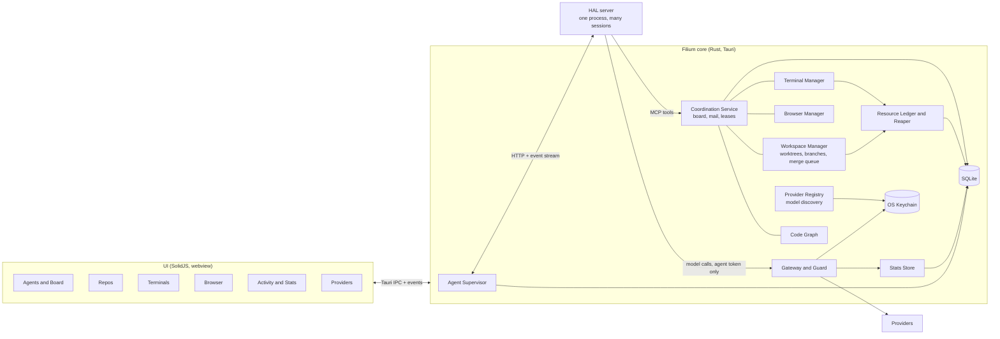
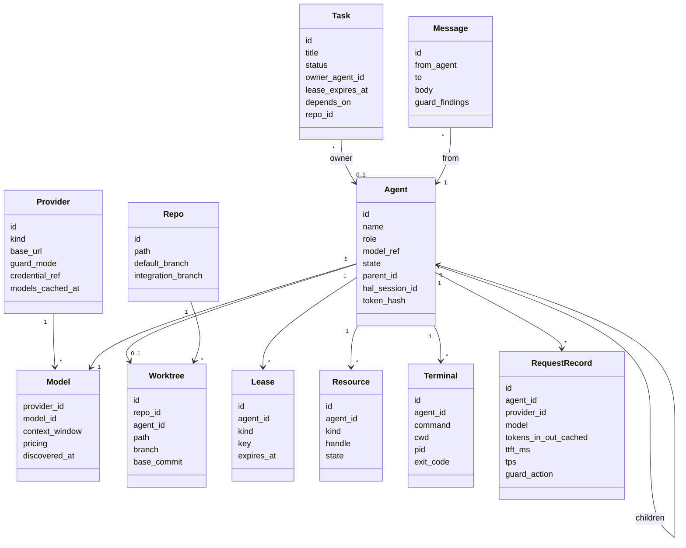
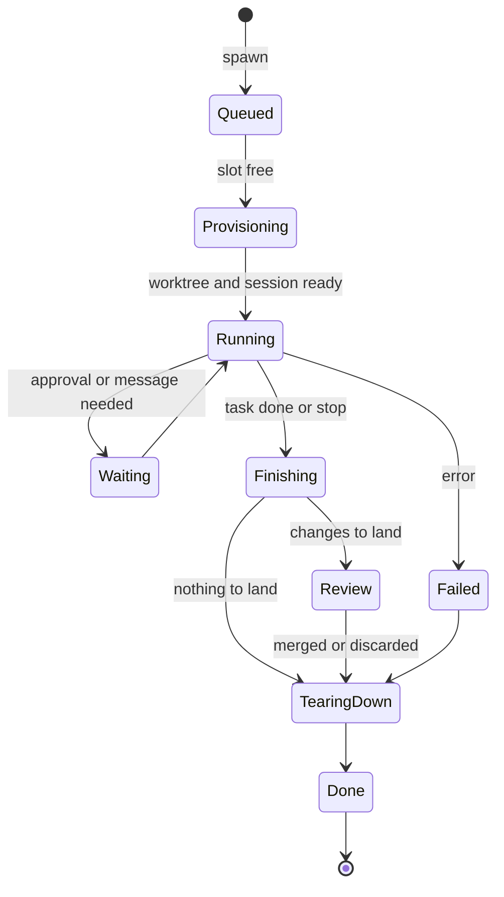
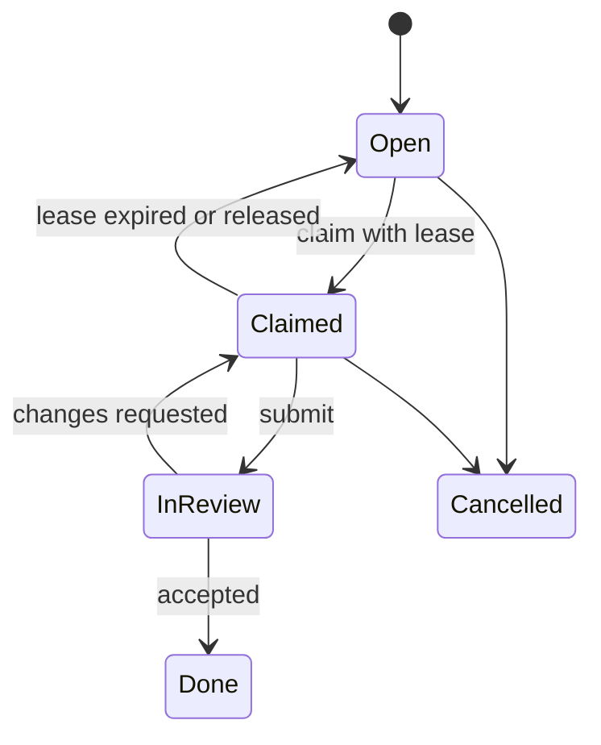
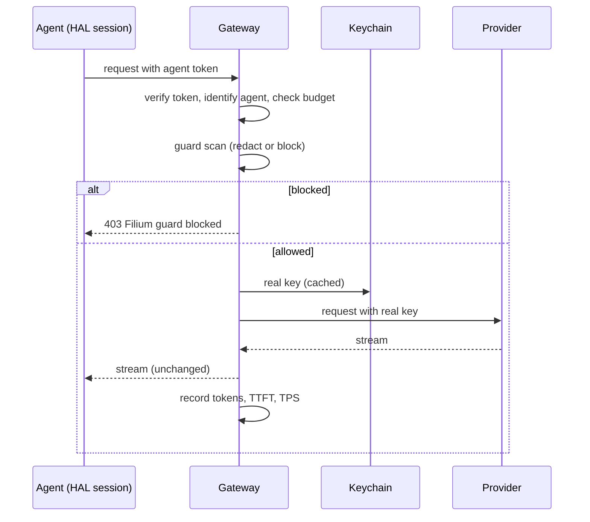
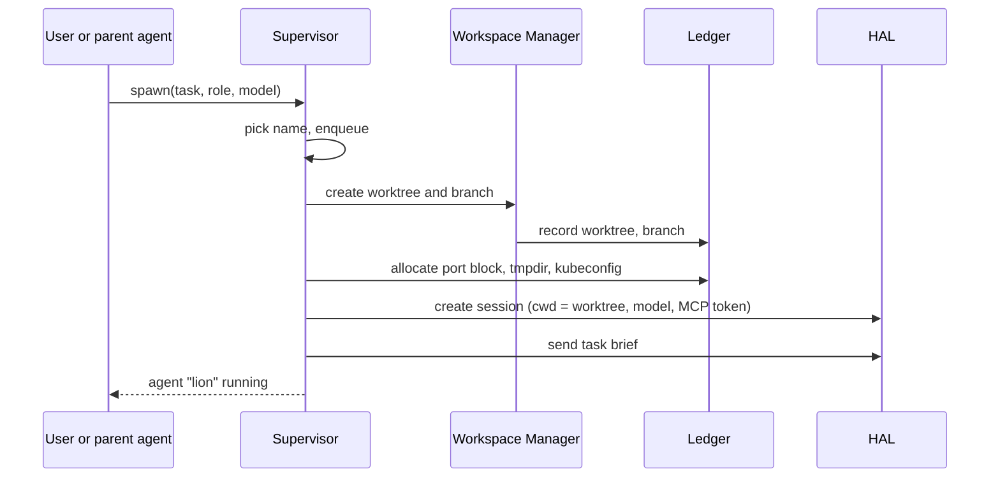
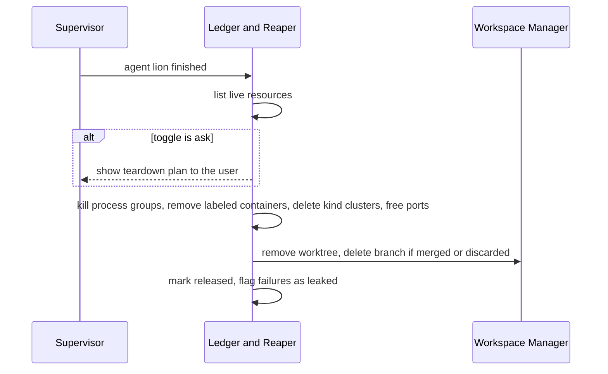

# Filium: Software Specification

Status: **draft v0.1** (2026-11-16). Open decisions are marked **[OPEN]**.

## 1. Purpose

Filium is a native, secure agent workstation. It replaces:

| Replaces | With |
|---|---|
| jcode / pi (harness) | HAL runtime driven by Filium, with named agents, a shared todo board and messaging |
| Herdr (terminals) | Persistent, live terminals owned by Filium |
| Orca (browser) | One built-in, interactive browser panel |
| Keys in env vars | A gateway that holds every credential and filters every request |

Design goals, in priority order:

1. **Safe with any provider.** Agents never hold real credentials. Every model request is inspected and logged.
2. **Agents never step on each other.** Each agent has its own workspace, resources and identity (section 6).
3. **Hundreds of agents on one machine.** The UI and supervisor cost almost nothing per idle agent.
4. **Nothing hardcoded.** Models are discovered live from providers.
5. **Leaves no mess.** Everything an agent creates is recorded and torn down.
6. **Premium, calm, dark UI.** Our own component set, inspired by affectUI's style (no copied code).

## 2. Requirements

### Functional

| ID | Requirement |
|---|---|
| F1 | Add a provider by picking a type (Claude Code, Codex, OpenAI-compatible) and pasting a key or signing in. |
| F2 | Model lists are fetched from each provider and refreshed. New models appear without a rebuild or restart. |
| F3 | All model traffic goes through the gateway: credential injection, secret redaction/blocking, logging. |
| F4 | Agents have unique names (lion, otter, ...), a role, a model and an owner (user or parent agent). |
| F5 | One master todo board shared by all agents. A task has one owner at a time. |
| F6 | Agents message each other (direct and broadcast) and hand off tasks. Messages are secret-scanned. |
| F7 | Each agent working on a repo gets its own git worktree and branch. |
| F8 | Repo view: repos, worktrees, branches, owning agent, dirty/ahead/behind state. |
| F9 | Every shell command an agent runs is visible as a live terminal. Terminals persist and can be reopened. |
| F10 | Built-in interactive browser panel that agents can drive and the user can watch and take over. |
| F11 | Resource ledger: processes, containers, kind clusters, ports, worktrees, branches, temp dirs per agent. |
| F12 | Teardown on agent finish, with a global toggle: **auto** or **ask**. Crash-recovery sweep at startup. |
| F13 | Statistics: tokens, cost, TPS, latency, cache hits, errors, guard hits, by provider/model/agent/repo/day. |
| F14 | Code graph (Graphify) per repo, exposed to agents as a cheap lookup tool. |
| F15 | Approvals: risky actions (push, delete, network, writes outside the workspace) show what will happen before you allow them. |

### Non-functional

| ID | Requirement |
|---|---|
| N1 | Idle agent overhead: no OS process, no rendered DOM, < 1 MB RAM in Filium. |
| N2 | UI renders only visible rows (virtualized). 1,000 agents in a list costs the same as 20. |
| N3 | One HAL server process for all agents. |
| N4 | macOS first. Windows and Linux follow without architectural change. |
| N5 | No secret is ever written to disk outside the OS keychain. Logs on disk hold metadata only. |
| N6 | Concurrency cap with a queue (default 20 active, configurable). Provider rate limits respected. |

## 3. Architecture



Key choice: **Filium offers its services to agents as MCP tools**, served by the core over loopback with a per-agent token. HAL stays unmodified. The token tells Filium which agent is calling, so every tool call is attributed and scoped to that agent.

### 3.1 Components

| Component | Responsibility |
|---|---|
| Agent Supervisor | Creates HAL sessions, assigns names, enforces the concurrency cap and queue, tracks state. |
| Coordination Service | Todo board, mailboxes, leases. Offered to agents as MCP tools. |
| Workspace Manager | Repo registry, worktree and branch lifecycle, merge queue, serialized git operations. |
| Resource Ledger | Records every resource an agent creates. The Reaper tears them down. |
| Terminal Manager | Owns all agent shell processes in PTYs. Keeps a ring buffer per terminal. |
| Browser Manager | One webview, created on first use. Agents take a lease to drive it. The user can take over. |
| Gateway and Guard | Exists today. Gains per-agent attribution, budgets and rate limits. |
| Provider Registry | Provider types, credentials (keychain), live model discovery and caching. |
| Stats Store | Aggregated counters in SQLite. Raw events kept for 30 days. |
| Code Graph | Builds and updates a Graphify index per repo. Answers lookups. |

## 4. Domain model



Enumerations:

- `Provider.kind`: anthropic, openai, openai_compatible, claude_code, codex
- `Provider.guard_mode`: off, redact, block
- `Lease.kind`: task, path, port_block, browser
- `Resource.kind`: process, container, compose_project, kind_cluster, port_block, worktree, branch, tmpdir
- `Resource.state`: live, released, leaked

## 5. Lifecycles

### 5.1 Agent



### 5.2 Task



A task can only be claimed when all of its `depends_on` tasks are Done.

## 6. Isolation: agents never step on each other

Every shared thing that agents could fight over gets one of three treatments: **each agent gets its own copy**, **it is leased to one agent at a time**, or **Filium serializes access**.

| Shared thing | Typical collision | Rule | Mechanism |
|---|---|---|---|
| Working tree | Two agents edit the same files | Own copy | One worktree per agent. The agent starts there. Writes outside it require approval. |
| Branches | Agents commit to the same branch | Own copy | Branch `filium/<agent>/<slug>`. Git refuses to check out one branch twice. Pushes to protected branches are denied. |
| Landing changes | Merge conflicts, broken main | Serialize | Merge queue: rebase on the integration branch, run checks, merge one at a time. Conflicts go back to the owning agent. |
| Git metadata | `index.lock` races | Serialize | Worktree create/remove, fetch and gc run through one Workspace Manager queue. |
| Tasks | Two agents do the same work | Lease | Claiming gives an exclusive lease with a heartbeat. An expired lease reopens the task. |
| Ports | `EADDRINUSE`, or an agent hits another agent's server | Own copy | Each agent gets a block of 20 ports (`FILIUM_PORT_BASE`). `PORT` defaults inside it. |
| Docker / compose | Name clashes, `down` kills others | Own copy | `COMPOSE_PROJECT_NAME=filium-<agent>`. A `docker` shim adds the label `filium.agent=<agent>`. |
| kind / Kubernetes | Shared kubeconfig, wrong context, deleted cluster | Own copy | Per-agent `KUBECONFIG`. A `kind` shim prefixes cluster names with `filium-<agent>-`. |
| Temp files | Overwrites | Own copy | Per-agent `TMPDIR`. Build caches stay shared (safe and fast). |
| Browser | Two agents drive one page | Lease | One browser lease at a time. Others wait or get their own tab. |
| Sibling worktrees | Agent reads or edits another agent's files | Deny | Path rules deny other agents' worktrees. |
| Credentials | Agent reads `~/.ssh` or cloud credentials | Deny | Environment scrubbed. Strict mode sandboxes the filesystem (section 9). |
| Model budget | One agent uses up all quota | Limit | Per-agent and per-provider token and rate budgets in the gateway. |

The shims (`docker`, `kind`, `git`, `kubectl`) live in a Filium `bin` folder placed first on the agent's `PATH`. They record created resources in the ledger and enforce naming. They are a convenience, not a security boundary. Strict mode is the boundary.

### 6.1 Agent environment

Every agent process starts with exactly this. Nothing that carries credentials is inherited.

```
FILIUM_AGENT=lion
FILIUM_PORT_BASE=42100
PORT=42100
TMPDIR=<state>/agents/lion/tmp
KUBECONFIG=<state>/agents/lion/kubeconfig
COMPOSE_PROJECT_NAME=filium-lion
PATH=<state>/bin:<user PATH>
```

## 7. Key flows

### 7.1 Model request



### 7.2 Spawn an agent on a task



### 7.3 Shell command


### 7.4 Teardown



At startup the Reaper compares the ledger with reality (running processes, `docker ps --filter label=filium.agent`, `kind get clusters`, `git worktree list`) and offers to clean up anything orphaned.

## 8. Agent tools (MCP, served by Filium)

| Tool | Purpose |
|---|---|
| `board.list / create / claim / update / submit` | Master todo board with leases |
| `mail.send / read / broadcast` | Messages between agents, guard-scanned |
| `agent.spawn / status / stop` | Start helpers (respects the cap) |
| `shell.run / write / kill` | Commands in persistent, visible PTYs |
| `browser.open / act / snapshot` | Drive the shared browser under a lease |
| `graph.query` | Code graph lookups instead of reading whole files |
| `resource.register` | Declare resources created outside the shims |

**[OPEN]** HAL's built-in shell tool is disabled through its permission rules, so that all execution goes through Filium (visible, attributed, reapable).

## 9. Security model

Trust boundaries:

1. **Provider** is untrusted. It sees only redacted requests and the key Filium injects.
2. **Agent / HAL** is semi-trusted. It holds only its own Filium token. No provider keys, no logins.
3. **Filium core** is trusted. It holds keys in the OS keychain.

| Level | What it adds | Cost |
|---|---|---|
| Standard (default) | Gateway, environment scrubbing, path rules, approvals, shims | None |
| Strict | Agent processes run in an OS sandbox. macOS: Seatbelt profile (files limited to the worktree and caches, network only to the gateway and an allowlist). Linux: Landlock and namespaces. | Low |
| Isolated **[OPEN]** | Agent in a container or VM, OpenShell-style | High, per agent |

Strict mode is the recommended setting for untrusted providers.

## 10. Performance budget (hundreds of agents)

| Item | Approach |
|---|---|
| Agents | HAL sessions, not processes. An idle agent is DB rows plus one event subscription. |
| UI | SolidJS, virtualized lists, events batched at 10 Hz. Agents not on screen get no DOM. |
| Terminals | Ring buffer in Rust (2 MB each, spilled to disk). Drawn only when open. |
| Browser | One webview, created on first use. |
| Stats | Counters aggregated in Rust, written to SQLite every few seconds. |
| Concurrency | Cap with a queue (N6). Shows CPU, memory, disk and rate-limit headroom. |

## 11. Storage layout

```
<app data dir>/            macOS: ~/Library/Application Support/dev.gunnarsson.filium
  filium.db                SQLite: agents, tasks, messages, leases, ledger, stats
  hal.yaml                 generated, 0600
  activity/                request metadata, rotated
  terminals/               spilled terminal buffers, rotated
  agents/<name>/           tmp, kubeconfig, scratch
  bin/                     shims
  graph/<repo>/            code graph indexes
<worktree root>/<repo>/<agent>/   [OPEN] location
```

## 12. UI map

| Screen | Content |
|---|---|
| Home | Running agents, board summary, alerts (approvals, guard hits, leaked resources) |
| Agents | Agent tree with name, model, state, task, resources. Conversation and terminals per agent |
| Board | Master todo board, grouped by status, with dependencies |
| Repos | Repos, worktrees, branches, owners, merge queue |
| Terminals | Grid or tabs of live terminals |
| Browser | Shared browser and the current lease holder |
| Activity | Every model request (exists today) |
| Stats | Usage, cost, TPS, efficiency by provider, model, agent, repo, day |
| Providers | Provider cards, sign-in or key, live model list |
| Settings | Teardown toggle, concurrency cap, security level, paths |

Command palette (Cmd K) on every screen.

## 13. Phases

| Phase | Scope |
|---|---|
| 1 | SolidJS and design system, provider setup with live models (F1, F2), SQLite store |
| 2 | Terminal Manager and MCP shell (F9), stats page (F13) |
| 3 | Workspace Manager, repo view, ledger and reaper (F7, F8, F11, F12) |
| 4 | Named agents, board, mail, leases, merge queue (F4 to F6) |
| 5 | Browser (F10), code graph (F14), strict mode |

## 14. Open decisions

1. UI framework: SolidJS (proposed) or Svelte.
2. Default concurrency cap: 20?
3. Finished work lands as a PR, a merge into an integration branch, or waits for review.
4. Worktree location: `~/Filium/worktrees` or next to each repo.
5. Disable HAL's built-in shell in favor of Filium's (section 8).
6. Claude Code and Codex subscriptions through the gateway, subject to those providers' terms.
7. Whether the "Isolated" level (containers) is needed at all.
